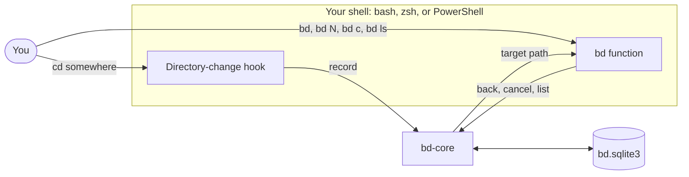
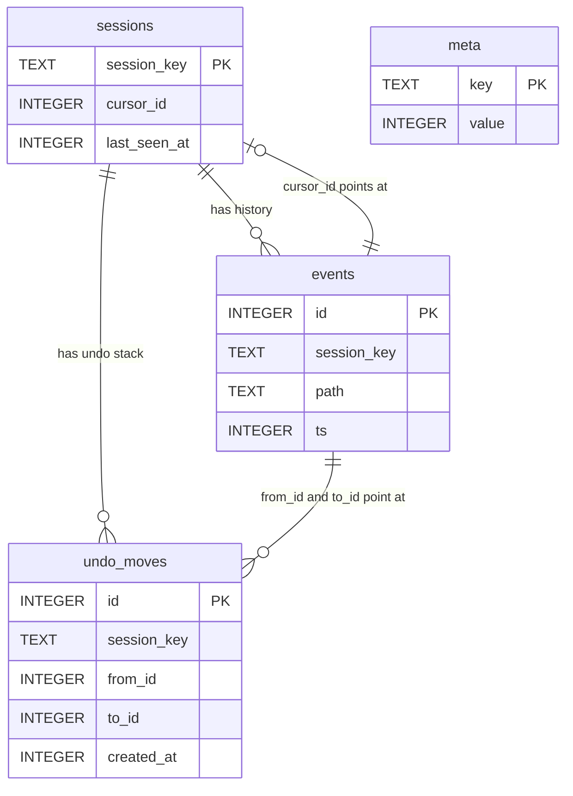
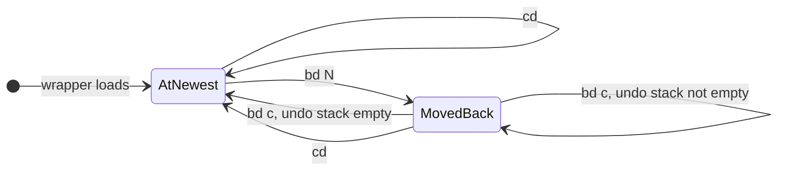
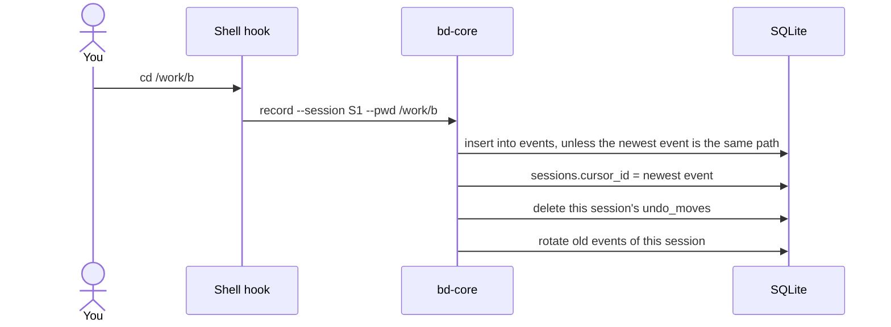
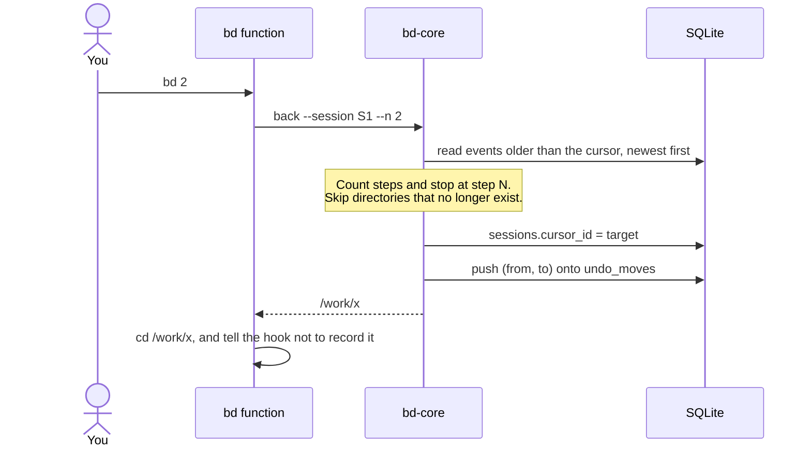
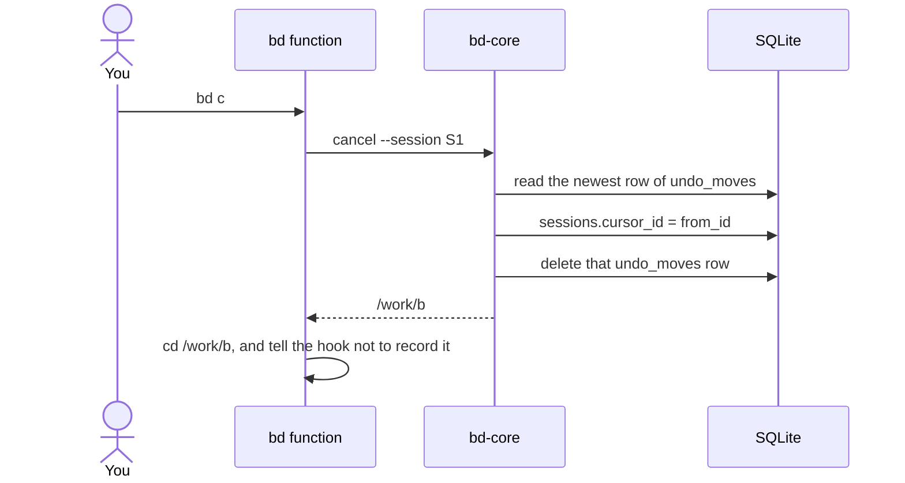
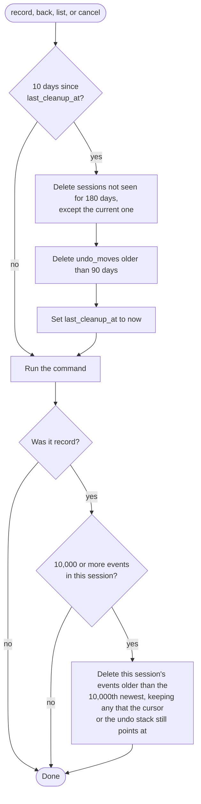

# Dataflow and cleanup

This document shows how `bd` records directory changes, how `bd N` and `bd c` move
through them, and how old data is removed. The diagrams render on GitHub.

## Components

`bd` is a shell function. It cannot be a plain binary, because a child process cannot
change the directory of the shell that started it. The shell part is kept small and the
Rust binary `bd-core` owns all state.

| Part | Where | Job |
| --- | --- | --- |
| Hook | `chpwd` (zsh), `PROMPT_COMMAND` (bash), `LocationChangedAction` or `prompt` (PowerShell) | Calls `bd-core record` after the directory changes |
| `bd` function | `scripts/bd.zsh`, `scripts/bd.bash`, `scripts/bd.ps1` | Checks arguments, asks `bd-core` for a path, then changes directory |
| `bd-core` | `src/main.rs` | Stores history, picks the target, keeps the undo stack |
| Database | `${XDG_STATE_HOME:-~/.local/state}/back-directory/bd.sqlite3`, or `%LOCALAPPDATA%\back-directory\bd.sqlite3` on Windows | One file shared by all shells |

Each shell is one session. The wrapper computes a session key when it loads (terminal and
process id in zsh, parent and process id plus host and user in bash, process id and start
time in PowerShell), unless `BD_SESSION_ID` is already set. Every row in the database
belongs to one session key.

## Tables

- `events`: one row per directory change, in order.
- `sessions`: where the session currently stands in its history (`cursor_id`).
- `undo_moves`: one row per `bd` move that can still be cancelled.
- `meta`: the time of the last cleanup (`last_cleanup_at`).

The links are by convention; the schema declares no foreign keys. `sessions` also has
`last_bd_*` columns that are written but no longer drive any decision. The full column
list is in [development.md](development.md#sqlite-schema).

## The cursor

A session is either at the newest event or somewhere behind it.

- `bd N` moves the cursor back and pushes the move onto the undo stack.
- `bd c` pops one move and puts the cursor back where that move started.
- A normal `cd` adds an event, moves the cursor to it, and clears the undo stack.

## What each command does

### A directory change (`record`)

The hook discards the output of `record`, so a failure here is silent. `bd doctor` shows
the state of the database.

### Going back (`bd N`)

- Directories that no longer exist still count as a step, but are never chosen. If step
  `N` is missing, the next older existing directory is used.
- If the history is shorter than `N`, `bd` goes to the oldest existing directory.
- The move itself is not added to `events`.

### Cancelling (`bd c`)

## Worked example

Start in `/work/x`, then `cd /work/a` and `cd /work/b`.

| Step | Command | `events` (id: path) | Cursor | Undo stack | You are in |
| --- | --- | --- | --- | --- | --- |
| 1 | `cd /work/b` | 1: x, 2: a, 3: b | 3 | empty | b |
| 2 | `bd 2` | 1: x, 2: a, 3: b | 1 | 3 → 1 | x |
| 3 | `bd c` | 1: x, 2: a, 3: b | 3 | empty | b |
| 4 | `bd 2` | 1: x, 2: a, 3: b | 1 | 3 → 1 | x |
| 5 | `cd /work/c` | 1: x, 2: a, 3: b, 4: c | 4 | empty | c |
| 6 | `bd` | 1: x, 2: a, 3: b, 4: c | 3 | 4 → 3 | b |

Step 6 lands in `b`, not in `x`, although `x` is where you were before `c`. `bd` walks the
log of `cd` commands, and the `bd 2` in step 4 is not part of that log. Whether this
should change is tracked in
[issue 10](https://github.com/masato-umeno/back-directory/issues/10).

## Cleanup

Two mechanisms keep the database small. Both run inside ordinary commands; there is no
background process.

| What | When | Rule |
| --- | --- | --- |
| Retention cleanup | At most once every 10 days | Remove sessions unused for 180 days and undo moves older than 90 days |
| Event rotation | On every `record` | Keep the newest 10,000 events of the session |

Known gap: retention cleanup removes the `sessions` row but leaves that session's
`events` rows behind. See
[issue 7](https://github.com/masato-umeno/back-directory/issues/7).

Space freed by deletes stays inside the file until `bd optimize` runs SQLite `VACUUM`.
`bd vacuum` is different: it deletes the database file and all history. See
[maintenance.md](maintenance.md).
