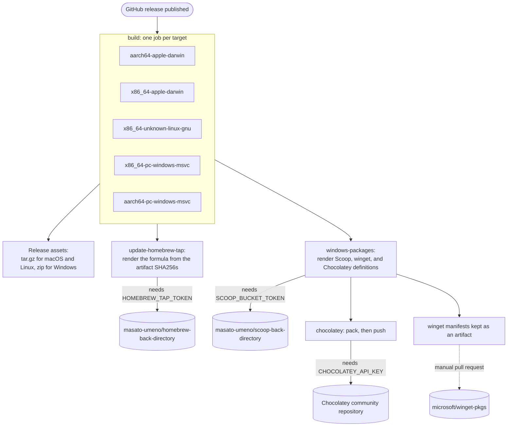

# Developer guide

## How it works

[dataflow.md](dataflow.md) has the diagrams: components, tables, what each command does
to the database, and cleanup.

`bd` is the user command provided by the shell wrappers (bash/zsh/PowerShell). The wrapper installs
lightweight hooks, validates arguments, and calls the Rust binary `bd-core`. `bd-core`
stores and queries history in SQLite, computes the target path (including cancel
behavior), and returns it to the wrapper, which then runs `builtin cd`.

We avoid heavy logic in zsh because the original pure-zsh version was slow and unreliable
under frequent directory changes and in multi-shell use. The Rust core centralizes state
management, enforces the `1..999` constraint, and keeps per-session cursor/cancel state.
Each session has its own history and cursor, so `bd` moves by directory-change events
rather than lines of history. The wrapper stays minimal to avoid conflicts with other
shell hooks like auto-`ls`. bash uses `PROMPT_COMMAND`, while zsh uses `chpwd` to detect
directory changes.

## Local setup

### Install (nix flakes)

From a local clone:

```sh
nix develop
```

This drops you into a shell with the Rust toolchain, shell runtimes (including PowerShell
where nixpkgs provides it), SQLite, shellcheck, actionlint, asciinema, and agg available. Run the same full check used by CI:

```sh
scripts/check.sh
```

If you already use `direnv`, allow the checked-in `.envrc` once and the flake shell will
load automatically when you enter the repository:

```sh
direnv allow
```

For one-off commands without entering a shell:

```sh
nix build .#bd-core
nix run .#bd-core -- --help
```

### Install (cargo)

```sh
# from a local clone
cargo install --path .

# or from git
# cargo install --git https://github.com/masato-umeno/back-directory
```

Ensure `bd-core` is on your `PATH` (default is `~/.cargo/bin`).

### Debugging from a local clone

If you want to run the wrapper from this repo while iterating on the core:

```sh
# from a local clone
cargo install --path . --force

# use the wrapper from this repo
mkdir -p ~/.config/back-directory
cp ./scripts/bd.bash ~/.config/back-directory/bd.bash
# bash
# source ~/.config/back-directory/bd.bash
cp ./scripts/bd.zsh ~/.config/back-directory/bd.zsh
# zsh
source ~/.config/back-directory/bd.zsh
```

If you prefer not to copy the wrapper, you can source it directly:

```sh
export BD_CORE_BIN="$HOME/.cargo/bin/bd-core"
source /path/to/your/clone/scripts/bd.bash
# or for zsh:
# source /path/to/your/clone/scripts/bd.zsh
```

## Development / CI

CI runs on pull requests and pushes to `main`. The recommended local check is:

```sh
nix develop --command scripts/check.sh
```

`nix flake check` builds and tests the Rust package and runs the distribution, workflow,
wrapper, isolated package lifecycle, and committed demo-media checks. The lifecycle tests
use temporary `HOME` and `XDG_STATE_HOME` directories and never source real shell rc files.

To keep `main` healthy, enable branch protection and require both `build-test` jobs
(`macos-latest` and `ubuntu-latest`) and the `windows` job to pass before merging.

### What the checks cover

```mermaid
flowchart LR
  check["scripts/check.sh"]

  subgraph rust["Rust"]
    fmt["cargo fmt --check"]
    clippy["cargo clippy"]
    test["cargo test"]
    build["cargo build --release"]
  end

  subgraph lint["Lint"]
    sc["shellcheck"]
    al["actionlint"]
  end

  subgraph smoke["Wrappers and packages"]
    e2e["e2e-smoke.sh: bash and zsh"]
    ps["e2e-smoke.ps1: PowerShell 7"]
    brew["test-homebrew-formula.sh"]
    win["test-windows-packages.sh"]
    life["test-package-lifecycle.sh"]
    demo["demo-media.sh check"]
  end

  check --> rust --> lint --> smoke
```



| Where it runs | What runs |
| --- | --- |
| Locally | `nix develop --command scripts/check.sh`, or `nix flake check` for a sandboxed run |
| CI `build-test` (macOS, Ubuntu) | `scripts/check.sh` |
| CI `windows` | clippy, tests, build, and `e2e-smoke.ps1` on Windows PowerShell 5.1 and PowerShell 7 |

### Release pipeline

Publishing a GitHub release starts `.github/workflows/release.yml`.



- A missing `HOMEBREW_TAP_TOKEN` fails the tap job. A missing Scoop or Chocolatey secret
  skips that channel with a warning.
- Running the workflow by hand (`workflow_dispatch`) builds the binaries and renders the
  Windows package definitions as artifacts, but publishes nothing and skips the tap job.

### Windows and PowerShell

`scripts/bd.ps1` is the PowerShell wrapper. It is embedded into `bd-core` and printed by
`bd-core init powershell`, so the profile line is the same for every package manager.
Keep the file ASCII-only: Windows PowerShell 5.1 reads BOM-less scripts in the ANSI code
page.

- Directory changes are recorded through `LocationChangedAction` on PowerShell 7+ and
  through a wrapped `prompt` function on Windows PowerShell 5.1. Setting the environment
  variable `BD_HOOK=prompt` before loading forces the prompt hook.
- Session keys are the PowerShell process id plus its start time, unless `BD_SESSION_ID`
  is set in the environment before loading.
- Only file system locations are recorded (not the registry or other providers).
- State lives in `%LOCALAPPDATA%\back-directory\bd.sqlite3`; `XDG_STATE_HOME` wins when set.

`scripts/e2e-smoke.ps1` is the PowerShell counterpart of `scripts/e2e-smoke.sh`. The Nix
shell provides PowerShell 7 where nixpkgs builds it (not on `x86_64-darwin`), so
`scripts/check.sh` runs the smoke test on macOS and Linux too. Windows PowerShell 5.1,
the Windows build of `bd-core`, and drive-letter paths are only exercised by the
`windows` CI job.

### Windows packages

`scripts/render-windows-packages.sh VERSION X64_SHA256 ARM64_SHA256 OUTPUT_DIR` renders
the Scoop manifest, the winget manifests, and the Chocolatey package from a version and
the SHA256 of the two release zips. The output is deterministic
(`scripts/test-windows-packages.sh` checks this), and rendered files are not committed.
No package edits the PowerShell profile.

The release workflow builds `bd-core-x86_64-pc-windows-msvc.zip` and
`bd-core-aarch64-pc-windows-msvc.zip` (each holds `bd-core.exe`, `bd.ps1`, and `LICENSE`),
renders the definitions, and keeps them as the `windows-packages` workflow artifact.
Publishing needs maintainer setup; a missing secret skips that channel with a warning.

| Channel | Automated by the release workflow | Maintainer setup |
| --- | --- | --- |
| Scoop | Pushes `bucket/back-directory.json` to `masato-umeno/scoop-back-directory` | Create the bucket repository; add a `SCOOP_BUCKET_TOKEN` secret that can push to it |
| Chocolatey | `choco pack`, then `choco push` to the community repository | Create a chocolatey.org account; add a `CHOCOLATEY_API_KEY` secret; answer moderation for new versions |
| winget | Renders the manifests only | Open a pull request to `microsoft/winget-pkgs` with the `winget/manifests/...` directory from the artifact (CLA and review required) |

The ARM64 binary is cross-compiled on an x64 runner, so CI builds it without running it.
The Chocolatey package installs the x64 build only.

## SQLite schema

The local state database is created on first use.

### events

Directory-change events captured by the shell hooks.

| Column | Type | Constraints | Description |
| --- | --- | --- | --- |
| id | INTEGER | PK, AUTOINCREMENT | Monotonic event id. |
| session_key | TEXT | NOT NULL, DEFAULT '' | Session identifier (TTY+PID by default). |
| path | TEXT | NOT NULL | Absolute path after the directory change. |
| ts | INTEGER | NOT NULL | Unix timestamp (seconds). |

Indexes:

- `idx_events_session_id` on `(session_key, id)`
- `idx_events_ts` on `(ts)`

### sessions

Per-session cursor and last `bd` move state.

| Column | Type | Constraints | Description |
| --- | --- | --- | --- |
| session_key | TEXT | PK | Session identifier. |
| cursor_id | INTEGER | NOT NULL | Current event id cursor in `events`. |
| last_bd_delta | INTEGER | NOT NULL, DEFAULT 0 | Last `bd N` delta used for cancel. |
| last_bd_from_id | INTEGER | NOT NULL, DEFAULT 0 | Event id before the last `bd` move. |
| last_bd_to_id | INTEGER | NOT NULL, DEFAULT 0 | Event id after the last `bd` move. |
| last_bd_armed | INTEGER | NOT NULL, DEFAULT 0 | Cancel toggle (0/1). |
| last_seen_at | INTEGER | NOT NULL, DEFAULT 0 | Last activity timestamp (seconds). |

### undo_moves

Stack of cancelable moves.

| Column | Type | Constraints | Description |
| --- | --- | --- | --- |
| id | INTEGER | PK, AUTOINCREMENT | Monotonic undo id. |
| session_key | TEXT | NOT NULL | Session identifier. |
| from_id | INTEGER | NOT NULL | Event id before the move. |
| to_id | INTEGER | NOT NULL | Event id after the move. |
| created_at | INTEGER | NOT NULL, DEFAULT 0 | Creation timestamp (seconds). |

Indexes:

- `idx_undo_moves_session_id` on `(session_key, id)`

### meta

Lightweight key/value store for maintenance metadata.

| Column | Type | Constraints | Description |
| --- | --- | --- | --- |
| key | TEXT | PK | Metadata key name. |
| value | INTEGER | NOT NULL | UNIX timestamp or numeric value. |

Current keys:

- `last_cleanup_at`: UNIX timestamp of the last cleanup run.

### Data cleanup

To prevent unbounded growth, the `events` table is rotated per session:

- When a session has 10,000+ events, the 10,000th newest event id becomes the rotation cutoff.
- Events older than the cutoff are deleted, but never past any id still referenced by
  `sessions` (`cursor_id`, `last_bd_from_id`, `last_bd_to_id`) or `undo_moves` (`from_id`, `to_id`).
- If there is no cursor/undo state yet, or the session has fewer than 10,000 events,
  no deletion occurs.

Additional retention cleanup runs about every 10 days:

- `sessions`: delete rows with `last_seen_at` older than 180 days (excluding the current session).
- `undo_moves`: delete rows with `created_at` older than 90 days.
- Cleanup scheduling uses `meta.last_cleanup_at`.


## Notes

- State lives in `~/.local/state/back-directory/bd.sqlite3` (or `$XDG_STATE_HOME`);
  on Windows, `%LOCALAPPDATA%\back-directory\bd.sqlite3`.
- History is isolated per session; each session has its own cursor and cancel state.
- Session keys default to TTY + shell PID, so each shell is its own session unless
  overridden via `BD_SESSION_ID`.
- Directory changes are captured via `PROMPT_COMMAND` (bash), `chpwd` (zsh), or
  `LocationChangedAction` / the `prompt` function (PowerShell); no `cd` wrapper or per-prompt writes.
