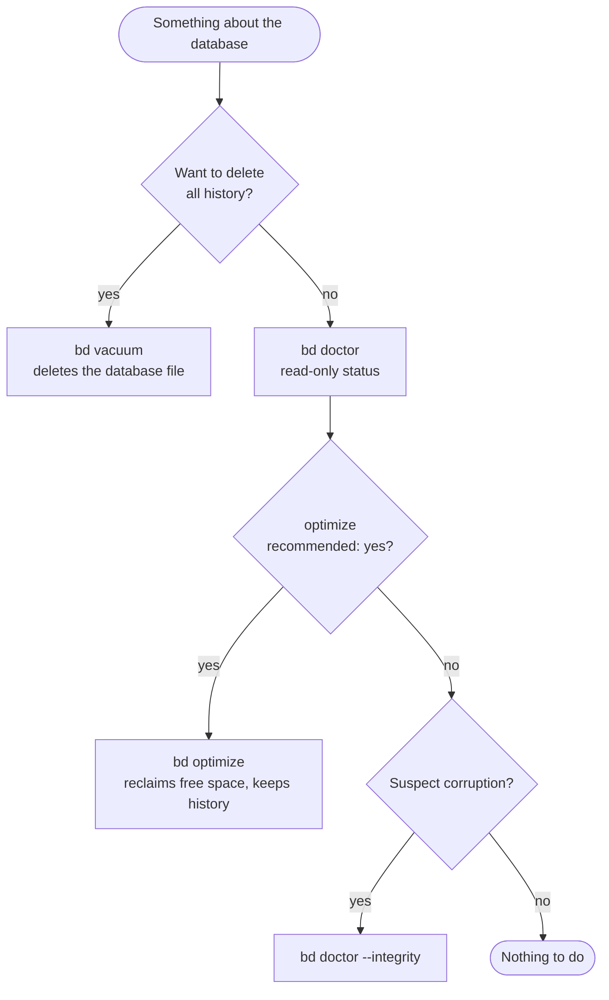

# Maintenance: optimize, vacuum, and doctor

This note documents best practices for database maintenance.

## Which command do I need?



| Command | Changes data? | Keeps history? | Use it to |
| --- | --- | --- | --- |
| `bd doctor` | No | Yes | Look at size, row counts, and the last cleanup |
| `bd optimize` | Rewrites the file | Yes | Shrink the file after many deletes (runs SQLite `VACUUM`) |
| `bd vacuum` | Deletes the file | No | Start over with an empty history |

The names are easy to mix up: `bd vacuum` is the destructive one.

## Principles

- `optimize` is manual only. Do not run it automatically.
- `vacuum` deletes all history and resets the SQLite DB.
- `doctor` is read-only by default; it should not change user data.
- Prefer predictable, low-impact checks for daily use.

## optimize best practices

- Run when no other shells are using `bd` to avoid write locks.
- In WAL mode, run a checkpoint before optimize:

```sh
sqlite3 ~/.local/state/back-directory/bd.sqlite3 "PRAGMA wal_checkpoint(TRUNCATE);"
```

You can run optimize via the CLI (it runs SQLite `VACUUM` internally):

```sh
bd optimize
```

## vacuum best practices

- Use only when you want to reset all history.
- This deletes the SQLite DB file (and WAL/SHM side files).
- The CLI will prompt for confirmation.

```sh
bd vacuum
```


## doctor best practices

- Default to quick checks (counts, size, freelist, last cleanup).
- Provide `--integrity` to include `PRAGMA integrity_check;`.
- Use `bd doctor --json` for machine-readable output.
- Surface clear OK/WARN thresholds, for example:
  - `freelist_count / page_count >= 0.2` → suggest optimize.
  - `last_cleanup_at` older than 30 days → suggest cleanup check.

## Notes

- WAL can create side files (`-wal`, `-shm`); this is expected.
- Removing `bd.sqlite3` resets all history and metadata.
